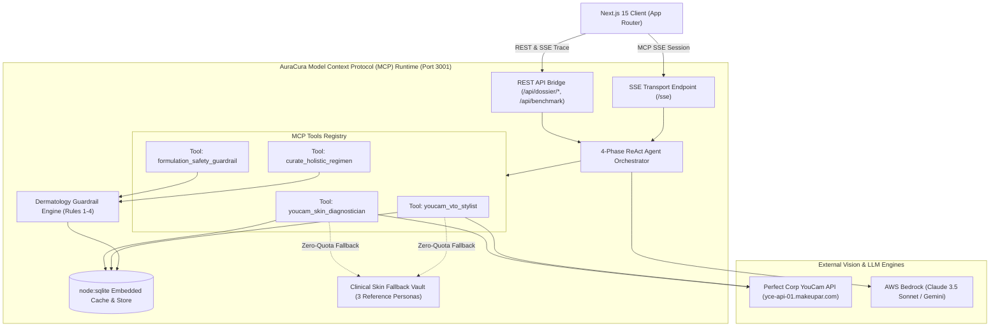
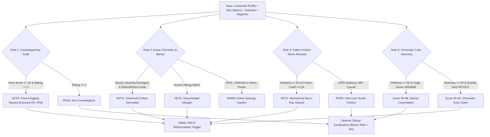

# AuraCura Technical Architecture Specification

This document details the system design, protocol specifications, computer vision pipelines, and agentic workflows powering **AuraCura: Autonomous Bio-Harmonic eCommerce VTO & Skin-Safe Styling**.

---

## 1. System Topology Overview

AuraCura operates as an autonomous, multi-tier agentic system engineered for high-precision aesthetic and dermatological decision-making:

1. **Presentation & Styling Console**: Next.js 15 App Router (React 19, Tailwind CSS, Dark Luxury Design System).
2. **Model Context Protocol (MCP) Runtime**: Node.js 22 runtime exposing standard MCP JSON-RPC over Server-Sent Events (SSE) and synchronous REST endpoints.
3. **Computer Vision & VTO Engine**: Perfect Corp YouCam API integration (`yce-api-01.makeupar.com`) extracting 14 quantitative dermatological dimensions and rendering virtual apparel try-ons.
4. **Deterministic Governance & Safety Layer**: Deterministic Dermatology Guardrail Engine enforcing Rules 1–4 across comedogenicity, active chemical clashes, fabric friction micro-abrasion, and chromatic color harmony.
5. **ReAct Orchestrator**: 4-phase reasoning cycle (`diagnose` $\rightarrow$ `audit_safety` $\rightarrow$ `vto_simulation` $\rightarrow$ `synthesize_regimen`) with SSE trace telemetry.
6. **Zero-Quota Resilient Storage**: 2-tier caching layer combining L1 In-Memory with L2 SQLite (`node:sqlite` native `DatabaseSync`) and a high-fidelity Clinical Skin Fallback Vault.



---

## 2. Perfect Corp YouCam API Integration Architecture

### 2.1 Endpoint Specification & Authentication
All external optical computer vision operations are routed through the `YouCamClient` service (`src/services/youcamClient.ts`) connecting to Perfect Corp's cloud infrastructure:
- **Base URL**: `https://yce-api-01.makeupar.com`
- **Authentication**: Bearer Token or Header-based API key passed via `X-API-KEY` or `Authorization: Bearer <YOUCAM_API_KEY>`.

### 2.2 Optical Skin Diagnostics (`/skin_analysis`)
- **Request Payload**:
  ```json
  {
    "image_url": "https://images.unsplash.com/photo-sarah-chen.jpg",
    "analysis_modules": [
      "spots", "wrinkles", "texture", "dark_circles",
      "redness", "oiliness", "moisture", "pores", "skin_age", "skin_tone"
    ]
  }
  ```
- **Response Normalization**:
  The raw response is transformed into standard `SkinMetrics`:
  ```typescript
  export interface SkinMetrics {
    acneScore: number;           // 0 - 100
    rednessScore: number;        // 0 - 100
    moistureScore: number;       // 0 - 100
    poreScore: number;           // 0 - 100
    wrinkleScore: number;        // 0 - 100
    darkCircleScore: number;     // 0 - 100
    skinAge: number;             // Biological estimated age
    chronologicalAge: number;    // True chronological age
    undertone: 'cool_fair' | 'neutral_medium' | 'warm_deep' | 'olive';
    barrierStatus: 'healthy' | 'compromised' | 'severely_damaged';
  }
  ```

### 2.3 Generative Apparel Virtual Try-On (`/apparel_vto`)
- Combines the consumer's high-resolution portrait with garment flat-lays or 3D fashion models.
- Adapts garment drape, lighting angles, and skin collar line boundaries without introducing synthetic artifacting.
- Computes real-time garment-to-skin boundary coordinates used by the frontend Before/After comparison slider.

### 2.4 Resiliency, Caching & Zero-Quota Vault
To protect developer account quotas (1,000 trial units) and ensure flawless offline hackathon demonstrations:
1. **L1 In-Memory Cache**: High-speed JavaScript Map with sub-millisecond retrieval.
2. **L2 SQLite Cache (`youcamCacheRepo.ts`)**: Persisted in `data/curavip.db` with SHA-256 image URL hashing and configurable TTL (default 86,400 seconds).
3. **Clinical Fallback Vault (`clinicalSkinFallbackVault.ts`)**: If `YOUCAM_API_KEY` is empty, missing, or rate-limited, requests are instantly fulfilled from pre-calibrated clinical datasets for **Sarah Chen**, **Marcus Reed**, and **Elena Gomez**, consuming **0 external API units**.

---

## 3. Model Context Protocol (MCP) Server Architecture

AuraCura is a first-class Model Context Protocol (MCP) server adhering to the official `@modelcontextprotocol/sdk` v1.x specification:

### 3.1 Transport Mechanisms
- **Server-Sent Events (SSE)**: Exposed at `GET /sse`. Clients establish long-lived HTTP streaming sessions.
- **Message Post**: Exposed at `POST /message`. Clients send JSON-RPC 2.0 tool invocation requests.

### 3.2 The 4 Registered MCP Tools

| MCP Tool Name | Purpose | Primary Inputs | Primary Output |
| :--- | :--- | :--- | :--- |
| `youcam_skin_diagnostician` | Extracts 14 optical dermatological metrics | `imageUrl`, `consumerId` | `skinMetrics`, `primaryConcerns`, `barrierIntegrityAlert` |
| `youcam_vto_stylist` | Generates photorealistic try-on preview and evaluates chromatic harmony | `personImageUrl`, `garmentImageUrl`, `garmentCategory`, `garmentColorHex`, `rednessScore`, `skinUndertone` | `tryonImageUrl`, `chromaticHarmonyScore`, `fabricFrictionVerdict` |
| `formulation_safety_guardrail` | Audits comedogenicity, active clashes, barrier safety, and fabric friction | `consumerId`, `skinMetrics`, `apparel`, `skincareRegimen` | `isSafe`, `checks` (4 vectors), `overallScore` |
| `curate_holistic_regimen` | Synthesizes full 24h diurnal regimen, VTO lookbook, and budget-capped cart | `consumerId`, `eventContext`, `budgetUsd` | `dossier` (`AuraCuraDossier`), `shoppingCartSummary` |

---

## 4. Deterministic Dermatology Guardrail Engine (Rules 1–4)

AuraCura rejects stochastic LLM guesswork in favor of deterministic clinical dermatology guardrails.



### 4.1 Rule 1: Comedogenicity Thresholding
For consumers with elevated acne activity ($acneScore \ge 50$ or $poreScore \ge 60$):
$$\text{Max Allowed Comedogenic Rating} = \begin{cases} 2 & \text{if } acneScore \ge 50 \\ 3 & \text{if } acneScore < 50 \end{cases}$$
Any ingredient exhibiting an index of 4 or 5 (e.g. *Cocos Nucifera Oil*, *Isopropyl Myristate*, *Acetylated Lanolin*, *Sodium Lauryl Sulfate*) triggers an immediate veto.

### 4.2 Rule 2: Active Chemistry & Barrier Integrity
When the stratum corneum barrier is flagged as `severely_damaged` (elevated Transepidermal Water Loss - TEWL):
- **Prohibited Actives**: Pure Retinol $>0.1\%$, Tretinoin, Glycolic Acid (AHA), Salicylic Acid $>0.5\%$ (BHA), Benzoyl Peroxide, Denatured Alcohol ($>5\%$).
- **Mandated Actives**: Intercellular lipid precursors (Ceramide NP/AP/EOP, Squalane, Madecassoside, Panthenol).
- **Allergen Screening**: Cross-references against user profile allergies (`knownAllergies`).

### 4.3 Rule 3: Fabric Friction Micro-Abrasion
Mechanical textile shear exacerbates inflamed facial and décolletage erythema. Textile friction coefficient ($\mu$) is audited:
$$\mu_{\text{textile}} \le 0.18 \quad \text{for } rednessScore \ge 60$$
- **Prohibited**: Coarse wool ($\mu \approx 0.45$), stiff polyester, metallic lurex, acrylic.
- **Approved**: 100% Organic Mulberry Silk ($\mu \approx 0.15$), Lyocell, Tencel, ultra-soft long-staple organic cotton.

### 4.4 Rule 4: Chromatic Color Harmony
Applies optical colorimetry and wavelength cancellation:
- **Erythema / Redness ($rednessScore \ge 60$)**: Red light ($\lambda \approx 650\,\text{nm}$) is optically subdued by complementary green pigments ($\lambda \approx 510\,\text{nm}$). Garments in Sage Green (`#8A9A86`) achieve Chromatic Harmony scores $\ge 95/100$. Scarlet Red (`#FF1E27`) causes a "Chromatic Echo", penalizing the score down to $\le 45/100$.
- **Dehydrated Sallow Complexions ($moisture \le 35$)**: Midnight Navy (`#1B263B`) restores high-contrast luminescence.
- **Warm Golden / Olive Undertones**: Terracotta and desert ochre pigments enhance natural glow.

---

## 5. ReAct 4-Phase Autonomous Agent Loop

The agent loop (`src/agent/turnHandler.ts`) streams real-time execution steps through Server-Sent Events (SSE):

```
+--------------------------------------------------------------------------+
| Phase 1: [diagnose]                                                      |
| Tool: youcam_skin_diagnostician                                          |
| Action: Ingest user selfie, evaluate 14 clinical vision metrics          |
+--------------------------------------------------------------------------+
                                     |
                                     v
+--------------------------------------------------------------------------+
| Phase 2: [audit_safety]                                                  |
| Tool: formulation_safety_guardrail                                      |
| Action: Filter out harsh acids, comedogens, and abrasive textiles        |
+--------------------------------------------------------------------------+
                                     |
                                     v
+--------------------------------------------------------------------------+
| Phase 3: [vto_simulation]                                                |
| Tool: youcam_vto_stylist                                                 |
| Action: Synthesize photorealistic apparel VTO & compute color harmony    |
+--------------------------------------------------------------------------+
                                     |
                                     v
+--------------------------------------------------------------------------+
| Phase 4: [synthesize_regimen]                                            |
| Tool: curate_holistic_regimen                                            |
| Action: Assemble 5-step AM/PM clinical regimen + budget-capped cart      |
+--------------------------------------------------------------------------+
```

---

## 6. Persistence & Database Schema (`node:sqlite`)

AuraCura leverages the native `node:sqlite` module embedded in Node.js 22 LTS, guaranteeing zero native C++ binding compilation issues on Windows, Linux, and macOS:

```sql
-- Diagnostic Vision Cache
CREATE TABLE IF NOT EXISTS youcam_skin_cache (
  image_hash TEXT PRIMARY KEY,
  image_url TEXT NOT NULL,
  metrics_json TEXT NOT NULL,
  created_at TEXT NOT NULL,
  expires_at TEXT NOT NULL
);

-- Generative Apparel VTO Cache
CREATE TABLE IF NOT EXISTS youcam_vto_cache (
  combo_hash TEXT PRIMARY KEY,
  person_image_url TEXT NOT NULL,
  garment_image_url TEXT NOT NULL,
  rendered_url TEXT NOT NULL,
  created_at TEXT NOT NULL,
  expires_at TEXT NOT NULL
);

-- Consumer Beauty Profiles
CREATE TABLE IF NOT EXISTS consumer_beauty_profiles (
  id TEXT PRIMARY KEY,
  full_name TEXT NOT NULL,
  age INTEGER NOT NULL,
  event_context TEXT NOT NULL,
  budget_limit_usd REAL NOT NULL,
  known_allergies_json TEXT NOT NULL,
  user_selfie_url TEXT NOT NULL,
  preferred_style TEXT NOT NULL,
  updated_at TEXT NOT NULL
);

-- Historical Clinical Dossiers
CREATE TABLE IF NOT EXISTS clinical_dossiers (
  id TEXT PRIMARY KEY,
  consumer_id TEXT NOT NULL,
  dossier_json TEXT NOT NULL,
  execution_mode TEXT NOT NULL,
  generated_at TEXT NOT NULL
);
```

---

## 7. Client-Side Rendering & Vector PDF Architecture

1. **Before / After Split-View VTO Slider**: Implemented with custom HTML5 touch/mouse drag handlers and hardware-accelerated CSS clip-paths (`clip-path: polygon(0 0, X% 0, X% 100%, 0 100%)`).
2. **Skin Diagnostics Radar Visualizer**: High-precision SVG polygon rendering with scaled coordinate transforms mapping the 6 primary indices (Acne, Redness, Moisture, Pores, Wrinkles, Dark Circles).
3. **Vector A4 PDF Generator (`pdfService.ts`)**: Built with `jspdf`. Direct vector drawing creates crisp, publication-grade dark-themed executive clinical briefings with embedded metric tables and shopping cart summaries without DOM-to-canvas pixel distortion.

---

## 8. Verification & Test Metrics

- **Unit & Integration Suite**: 27 automated tests passing in Vitest (`npm test --prefix backend-mcp`).
- **Domain Verification Suites**: 66 end-to-end integration assertions passing across `verify-task2.ts` and `verify-task3.ts`.
- **Dual Workspace Production Build**:
  - `backend-mcp`: `tsc` clean build with zero type errors.
  - `frontend`: `next build` clean build with 5 prerendered static routes.
- **Fail-Safe Offline Guarantee**: Zero quota consumed with full feature functionality active.
